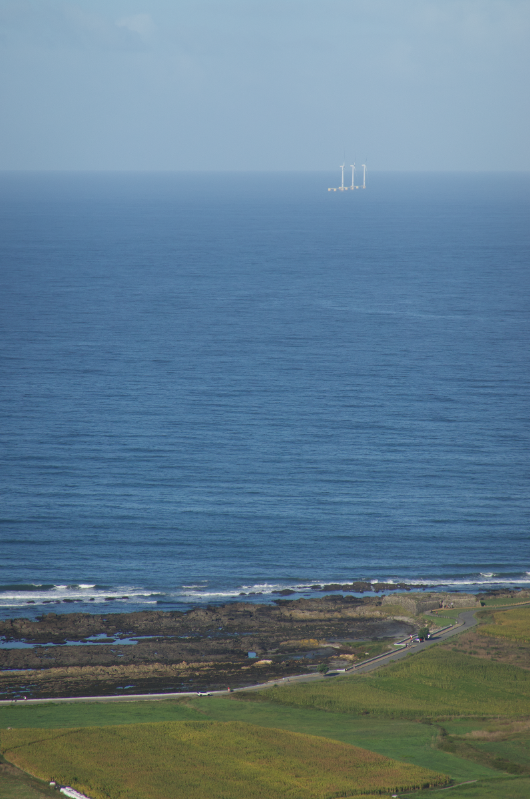

El año pasado tuve la inmensa suerte de trabajar en un proyecto de eólica marina. Lo cierto es que si bien no he tenido la oportunidad de construir una base sólida sobre el funcionamiento de las plataformas e instalaciones del Oil & Gas, trabajar en este proyecto me abrió los ojos de una industria creciente que alberga una complejidad brutal junto con un pronóstico de desarrollo muy grande.

Por ende, a principios de año decidí comencé a formarme en la industria eólica offshore de la mano del Instituto Marítimo Español (IME). Lo hice fundamentalmente porque mientras trabajaba en el WindFarm de Viana do Castelo, me di cuenta de que realmente no alcanzaba a comprender el funcionamiento de un parque, su desarrollo, la distribución de la energía, ni las variables que influyen en su diseño. Buscaba por tanto en esta formación adquirir los conocimientos y entendimiento necesarios en el sector de la energía eólica marina que como Oficial de Puente no podía construir por estar demasiado enfocado en la fase operativa del barco.

La decisión de tomar esta formación fue también motivada por el deseo de experimentar con nuevos centros de formación y nuevas metodologías de aprendizaje. No nuevas en sí, pues el *delivery* del curso iba a ser através del Learning Management System de Bureau Veritas Formación. Lo que sí es cierto es que sí era a través de una institución con la que nunca me había formado antes: el Instituto Martímo Español (que colabora con BV para el desarrollo de algunas de sus formaciones).

El curso comenzó en Febrero y duraba hasta finales de noviembre. Se trabajaron 6 Temas, todos de estructura similar. Básicamente había un tema para cada mes, salvando el mes de Agosto, dónde no hubo ninguna actividad lectiva programada.

Cada tema se compuso de 3 Unidades Didácticas (en total 18 Unidades Didácticas) en formato SCORM que además, se podían descargar en PDF (esto fue ideal para poder trabajar los contenidos con conectividad limitada). Cada una de las unidades didácticas con un pequeño cuestionario asociado de unas pocas preguntas. Cada uno de los seis temas, tenía además de los cuestionarios, un caso práctico entregable. De estos 6 casos prácticos (uno por tema),

